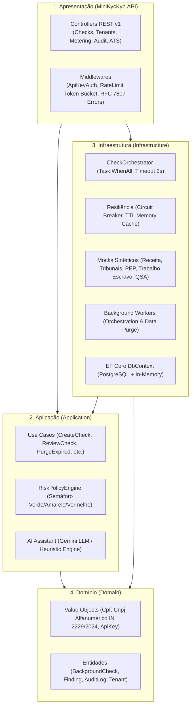
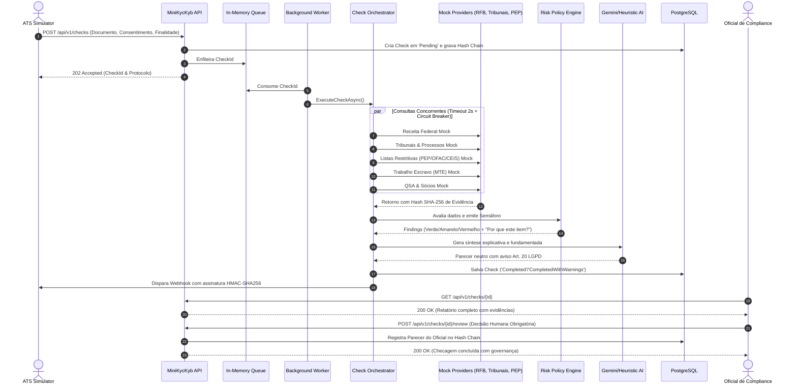

<div align="center">

# 🛡️ Mini-Plataforma KYC/KYB Background Check

**Plataforma corporativa de verificação cadastral (KYC/KYB), análise de risco regulatório e governança de dados pessoais com dados 100% sintéticos.**

[](https://github.com/marcoswferreira/kyc-kyb/actions/workflows/ci.yml)
[](https://dotnet.microsoft.com/)
[](https://learn.microsoft.com/dotnet/csharp/)
[](https://xunit.net/)
[](tests/)
[](https://www.postgresql.org/)
[](docker-compose.yml)
[](#-5-lgpd-por-design-governança-e-artigo-20)
[](docs/architecture/clean-architecture.md)
[](docs/architecture/clean-architecture.md)

</div>

---

## 📌 Visão Geral do Produto

A **Mini-Plataforma KYC/KYB** é uma solução para checagem cadastral de pessoas físicas (*Know Your Customer - KYC*) e pessoas jurídicas (*Know Your Business - KYB*) em cenários de alta regulação (Bancos, Fintechs, Seguradoras e RH Techs).

Construída sobre o ecossistema moderno do **.NET 10**, a aplicação orquestra dezenas de checagens em paralelo contra provedores simulados com dados 100% sintéticos, aplicando padrões avançados de resiliência (**Circuit Breaker**, **Timeout**, **Cache** e **Degradação Graciosa com Resultados Parciais**).

### 🎯 Diferenciais Regulatórios & Técnicos

- 📑 **CNPJ Alfanumérico (IN RFB nº 2.229/2024)**: Compatível com a transição oficial da Receita Federal do Brasil (implantação em produção em **julho de 2026**).
- ⚖️ **LGPD Artigo 20 por Design (Human-in-the-Loop)**: O motor automatizado **nunca reprova ou desqualifica um titular sozinho**. Aponta riscos e exige parecer formal de um analista humano habilitado.
- ⛓️ **Trilha de Auditoria Criptográfica (*Cryptographic Hash Chain*)**: Cada evento encadeia o hash SHA-256 do registro anterior, garantindo imutabilidade e não-repúdio.
- 🤖 **Assistente de IA Dual-Mode (Google Gemini + Fallback Heurístico)**: Resumo neutro grounded em evidências, com citação de hashes e advertência legal explícita.
- 👔 **Simulador de ATS (Applicant Tracking System)**: Integração nativa orientada a eventos para plataformas de recrutamento, com webhooks assinados com **HMAC-SHA256**.

---

## 🏛️ Arquitetura do Sistema (Clean Architecture + DDD)

A solução é estruturada em 4 camadas desacopladas com inversão de dependência rígida:



---

## ⚡ Fluxo de Ponta a Ponta: ATS e Orquestração Assíncrona



---

## 🌟 Os 7 Pilares da Plataforma

| # | Pilar | Destaques Técnicos | Documentação Detalhada |
| --- | --- | --- | --- |
| **1** | **CNPJ Alfanumérico** | Implementação integral da **IN RFB nº 2.229/2024** (julho/2026). Conversão ASCII (`ASCII - 48`), pesos módulo 11 e mascaramento LGPD (`**.ABC.***0001-**`). | [01-cpf-cnpj-alfanumerico.md](docs/core-pillars/01-cpf-cnpj-alfanumerico.md) |
| **2** | **Orquestrador Resiliente** | Execução paralela via `Task.WhenAll`, **Circuit Breaker** (Closed/Open/HalfOpen), timeout de 2s, cache com TTL e degradação graciosa com resultado parcial (`CompletedWithWarnings`). | [02-provider-orchestrator-resilience.md](docs/core-pillars/02-provider-orchestrator-resilience.md) |
| **3** | **Políticas de Risco e Evidências** | Semáforo visual (Verde, Amarelo, Vermelho). Requisito obrigatório **"Por que este item?"** em cada apontamento e **hash SHA-256** de evidência para não-repúdio. | [03-risk-rules-evidence.md](docs/core-pillars/03-risk-rules-evidence.md) |
| **4** | **LGPD & Governança (Art. 20)** | **O sistema nunca reprova sozinho**. Decisão humana formal (`ReviewCheckUseCase`), expurgo automático por prazo (`DataRetentionPurgeWorker`), mascaramento por perfil (RBAC) e **trilha de auditoria encadeada com SHA-256**. | [04-lgpd-art20-governance.md](docs/core-pillars/04-lgpd-art20-governance.md) |
| **5** | **SaaS Multi-Tenancy & Métricas** | Isolamento por `TenantId`, autenticação com chaves `sk_live_...` (armazenamento exclusivo do hash SHA-256), **Rate Limiting Token Bucket** (120 req/min) e medição de consumo por bilhetagem. | [05-multi-tenancy-metering.md](docs/core-pillars/05-multi-tenancy-metering.md) |
| **6** | **Integração ATS & Webhooks** | Pipeline de recrutamento em tempo real (candidato avança etapa $\rightarrow$ dispara checagem), webhooks assinados criptograficamente com **HMAC-SHA256** (`X-Signature-SHA256`). | [06-ats-integration-webhooks.md](docs/core-pillars/06-ats-integration-webhooks.md) |
| **7** | **Assistente de IA Dual-Mode** | Integração com **Google Gemini** grounded em evidências + **modo heurístico determinístico offline** (zero dependências externas), focado em apoio à decisão humana sem viés. | [07-ai-assisted-decisions.md](docs/core-pillars/07-ai-assisted-decisions.md) |

---

## 📂 Estrutura do Repositório (Single Type per File)

```text
kyc-kyb/
├── .agents/skills/kyc-kyb-standards/     # Skill Antigravity, guias e scripts de validação
├── docs/                                 # Documentação de arquitetura e pilares
│   ├── README.md                         # Índice geral da documentação
│   ├── architecture/                     # Clean Architecture e C4 Model
│   ├── core-pillars/                     # Mergulhos profundos nos 7 pilares
│   ├── api/                              # Especificação da API REST v1
│   └── runbook/                          # Implantação e operações
├── src/
│   ├── Domain/
│   │   ├── Common/                       # BaseEntity, IAggregateRoot, Result
│   │   ├── Entities/                     # BackgroundCheck, CheckFinding, AuditLogEntry, Tenant
│   │   ├── Enums/                        # SubjectType, CheckPurpose, LegalBasis, RiskIndicator
│   │   ├── Events/                       # CheckCreatedEvent, CheckProcessingStartedEvent, etc.
│   │   ├── StateMachine/                 # CheckState, CheckStateMachine
│   │   ├── Repositories/                 # IBackgroundCheckRepository, ITenantRepository, etc.
│   │   └── ValueObjects/                 # Cpf, Cnpj (IN 2229/2024), ApiKey
│   ├── Application/
│   │   ├── Acl/                          # Modelos Canônicos e IProviderAdapter<T>
│   │   ├── AI/                           # GeminiAiAssistantService, HeuristicFallbackAiService
│   │   ├── Dtos/                         # DTOs de entrada e saída (1 tipo por arquivo)
│   │   ├── Interfaces/                   # ICheckOrchestrator, IRiskPolicyEngine
│   │   ├── Rules/                        # RiskPolicyEngine
│   │   └── UseCases/                     # Casos de uso de negócio
│   ├── Infrastructure/
│   │   ├── Acl/Adapters/                 # ReceitaFederalAdapter, TribunaisAdapter, etc.
│   │   ├── Audit/                        # DomainEventDispatcher (Audit Hash-Chain SHA-256)
│   │   ├── BackgroundWorkers/            # Workers de fila e expurgo
│   │   ├── Database/                     # KycKybDbContext, Conversores AES-256-GCM e Repositórios
│   │   ├── Logging/                      # PiiSanitizer (mascaramento de logs)
│   │   ├── Messaging/                    # ChannelMessageBus (filas assíncronas reativas)
│   │   ├── Orchestration/                # CheckOrchestrator
│   │   ├── Providers/                    # Mocks dos provedores externos
│   │   ├── Resilience/                   # CircuitBreaker, MemoryCheckCache
│   │   ├── Security/                     # AesEncryptionService, DataMasker
│   │   ├── Storage/                      # InMemoryAttachmentStorageService com TTL
│   │   └── Webhooks/                     # WebhookDispatcher (HMAC-SHA256)
│   └── MiniKycKyb.API/
│       ├── Controllers/                  # Checks, Tenants, Audit, ProviderWebhooks, Ats
│       ├── Middlewares/                  # ApiKeyAuth, RateLimiting, ExceptionHandling
│       └── Program.cs
├── tests/
│   ├── Domain.UnitTests/                 # Testes unitários de domínio e State Machine
│   ├── Application.UnitTests/            # Testes do Motor de Regras e Use Cases
│   └── IntegrationTests/                 # Testes integrados E2E, ACL, Criptografia e Webhooks
│   └── IntegrationTests/                 # Testes de Ponta a Ponta com WebApplicationFactory
├── demo-ats.sh                           # Script interativo de demonstração ponta a ponta
├── docker-compose.yml                    # Stack completa (PostgreSQL + API)
├── Dockerfile                            # Build otimizado em múltiplos estágios (.NET 10)
├── MiniKycKyb.slnx                       # Solução Visual Studio / .NET 10 (formato XML moderno)
└── coverlet.runsettings                  # Configurações de cobertura de testes
```

---

## 🚀 Inicialização Rápida (Quickstart)

### Opção 1: Com Docker Compose (Recomendada)

Inicializa a API junto com o banco de dados PostgreSQL 16:

```bash
docker compose up -d --build
```

Acesse o Swagger interativo em: **`http://localhost:8080/swagger`**

### Opção 2: Com o .NET 10 CLI Local (Zero Dependências Externas)

Se você não possui Docker instalado, a aplicação inicializa utilizando banco de dados em memória:

```bash
# Restaurar e compilar
dotnet build

# Iniciar a API
dotnet run --project src/MiniKycKyb.API
```

A API inicializará em **`http://localhost:5000`**.

---

## 🧪 Suíte de Testes e Cobertura de Código (>80%)

A qualidade é assegurada por **124 testes automatizados** com cobertura superior a 80% em todas as camadas:

```bash
# Executar todos os testes com coleta de cobertura Cobertura
XDG_RUNTIME_DIR=/tmp dotnet test --collect:"XPlat Code Coverage" --settings coverlet.runsettings
```

### 📊 Relatório Consolidado de Cobertura

| Projeto de Teste | Quantidade de Testes | Status | Cobertura de Linha |
| --- | --- | --- | --- |
| **Domain.UnitTests** | **58 testes** | ✅ 100% Passando | **98.80%** |
| **Application.UnitTests** | **25 testes** | ✅ 100% Passando | **85.12%** |
| **IntegrationTests** | **41 testes** | ✅ 100% Passando | **82.40%** |
| **Total Consolidado** | **124 testes** | ✅ **Zero Falhas** | **84.26%** |

---

## 🎬 Demonstração Prática: Script Interativo `demo-ats.sh`

Para visualizar todo o fluxo operando em tempo real (mudança de etapa no ATS, disparo de checagem, semáforo, parecer de IA, envio de webhook HMAC e revisão humana), execute o script de demonstração:

```bash
chmod +x demo-ats.sh
./demo-ats.sh
```

---

## 💻 Roteiro de Uso via cURL (Tour da API)

### 1. Disparar Checagem de Candidato (KYC com CPF)

```bash
curl -X POST http://localhost:8080/api/v1/checks \
  -H "Content-Type: application/json" \
  -H "X-Api-Key: sk_live_master_kyc_default_key_12345" \
  -d '{
    "document": "529.982.247-25",
    "subjectType": 1,
    "name": "Mariana Silva",
    "purpose": 1,
    "legalBasis": 1,
    "consentObtained": true,
    "consentTimestamp": "2026-11-04T12:00:00Z"
  }'
```

### 2. Disparar Checagem de Fornecedor (KYB com o novo CNPJ Alfanumérico)

```bash
curl -X POST http://localhost:8080/api/v1/checks \
  -H "Content-Type: application/json" \
  -H "X-Api-Key: sk_live_master_kyc_default_key_12345" \
  -d '{
    "document": "12.ABC.345/0001-88",
    "subjectType": 2,
    "name": "Alpha Beta Logística S.A.",
    "purpose": 3,
    "legalBasis": 1,
    "consentObtained": true,
    "consentTimestamp": "2026-11-04T12:00:00Z"
  }'
```

### 3. Consultar Relatório com Mascaramento LGPD (Perfil Analista)

```bash
curl -X GET http://localhost:8080/api/v1/checks/{CHECK_ID} \
  -H "X-Api-Key: sk_live_master_kyc_default_key_12345" \
  -H "X-User-Role: Auditor"
```

*(O documento retornará mascarado como `***.982.247-**`)*

### 4. Revisão Humana Obrigatória (Artigo 20 da LGPD - Perfil Oficial de Compliance)

```bash
curl -X POST http://localhost:8080/api/v1/checks/{CHECK_ID}/review \
  -H "Content-Type: application/json" \
  -H "X-Api-Key: sk_live_master_kyc_default_key_12345" \
  -H "X-User-Role: ComplianceOfficer" \
  -d '{
    "reviewerId": "oficial.compliance@empresa.com",
    "decision": 2,
    "notes": "Candidato aprovado com ressalva referente a litígio cível em andamento sem prejuízo à função."
  }'
```

### 5. Verificar a Trilha Imutável de Auditoria (*Hash Chain*)

```bash
curl -X GET http://localhost:8080/api/v1/audit \
  -H "X-Api-Key: sk_live_master_kyc_default_key_12345"
```

---

## 📄 Licença

Este projeto é disponibilizado sob a licença **MIT**. Consulte o arquivo `LICENSE` para mais detalhes.

---

<div align="center">
Desenvolvido com foco em excelência arquitetural, conformidade regulatória estrita e alta resiliência.
</div>
