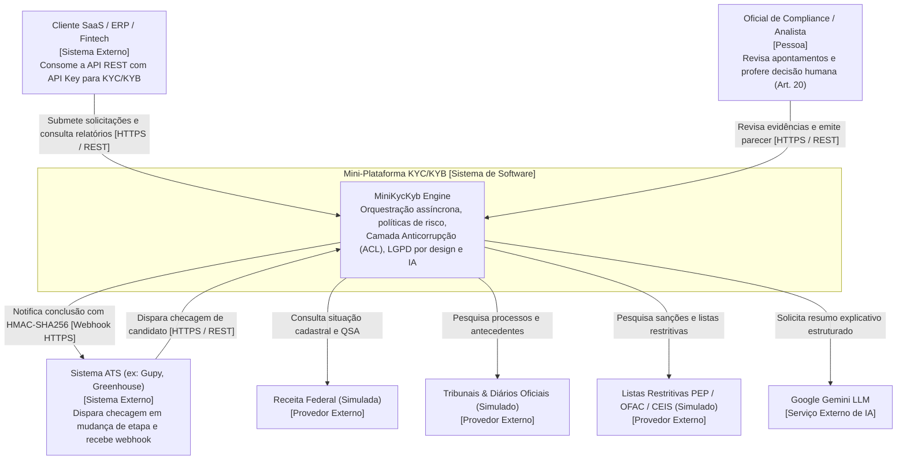
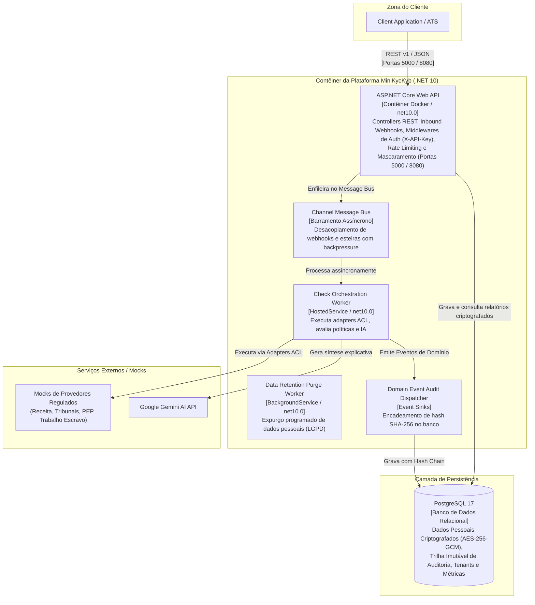
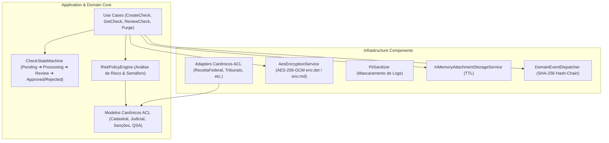

# C4 Model: Visão Arquitetural da Plataforma KYC/KYB

O modelo C4 (Contexto, Contêineres, Componentes e Código) fornece uma representação gráfica e conceitual da plataforma em múltiplos níveis de abstração.

---

## 🌐 Nível 1: Diagrama de Contexto de Sistema (Context)

Ilustra como a plataforma interage com usuários, sistemas externos e fontes de dados.

---

## 📦 Nível 2: Diagrama de Contêineres (Container)

Detalha os serviços executáveis, bancos de dados e canais de mensageria da solução.

---

## 🧩 Nível 3: Diagrama de Componentes da Aplicação

