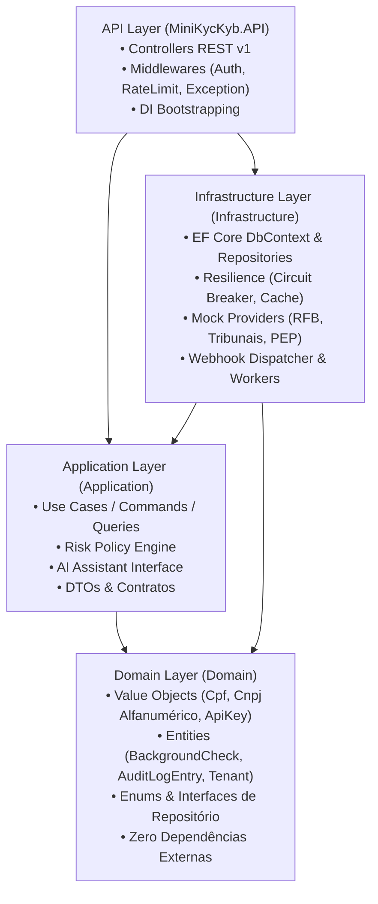
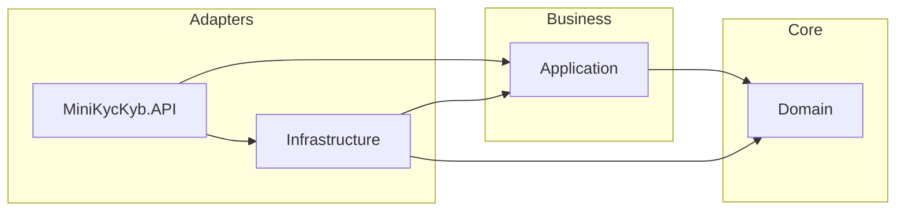

# Clean Architecture & Padrões Estruturais

A **Mini-Plataforma KYC/KYB Background Check** foi concebida seguindo rigorosamente os preceitos da **Clean Architecture** (Robert C. Martin) combinados com princípios de **Domain-Driven Design (DDD)**. O objetivo central é manter as regras de negócio regulatórias (como cálculo de CNPJ, classificação de riscos e conformidade LGPD) 100% isoladas de tecnologias voláteis (banco de dados, frameworks web e APIs externas).

---

## 🏛️ Visão Geral em Camadas

---

## 📦 Detalhamento das Camadas

### 1. Camada de Domínio (`src/Domain`)
É o núcleo da aplicação. Não possui dependências externas ou pacotes NuGet de terceiros.
- **Value Objects**:
  - `Cpf`: Validação oficial de 11 dígitos por módulo 11, rejeição de sequências idênticas e máscara LGPD (`***.456.789-**`).
  - `Cnpj`: Suporta tanto o CNPJ tradicional de 14 dígitos quanto o novo **CNPJ Alfanumérico da Instrução Normativa RFB nº 2.229/2024**. Converte caracteres ASCII para inteiros (`ASCII - 48`) e aplica pesos módulo 11.
  - `ApiKey`: Gera chaves no formato seguro `sk_live_...` e armazena apenas seu hash SHA-256 no banco, com verificação em tempo constante (`CryptographicOperations.FixedTimeEquals`).
- **Entidades de Domínio**:
  - `BackgroundCheck`: Agregado raiz da verificação cadastral. Controla estados (`Pending`, `Processing`, `Completed`, `CompletedWithWarnings`, `Failed`), prazos de retenção e decisão humana (Art. 20 LGPD).
  - `CheckFinding`: Apontamento estruturado (Verde, Amarelo, Vermelho), contendo o "Por que este item?" e o hash da evidência.
  - `AuditLogEntry`: Registro imutável de auditoria encadeado criptograficamente com o registro anterior (*Hash Chain*).
  - `Tenant`, `UsageMetric`, `WebhookSubscription`.
- **Interfaces de Repositório**:
  - `IBackgroundCheckRepository`, `ITenantRepository`, `IAuditLogRepository`, `IUsageMetricRepository`, `IWebhookSubscriptionRepository`.

### 2. Camada de Aplicação (`src/Application`)
Orquestra os fluxos de trabalho e abriga os motores de regras de negócio.
- **Motores de Regras**:
  - `IRiskPolicyEngine` / `RiskPolicyEngine`: Avalia os dados brutos retornados pelos provedores e emite os indicadores Verde, Amarelo ou Vermelho com a devida justificativa e categoria (`Cadastral`, `Judicial`, `Restritiva`, `TrabalhoEscravo`, `Societario`).
- **Serviços de IA**:
  - `IAiAssistantService`: Interface abstrata para geração de parecer de conformidade.
  - `GeminiAiAssistantService`: Integração com Google Gemini REST API via HTTP seguro.
  - `HeuristicFallbackAiService`: Motor determinístico em C# que funciona offline, citando fontes e assegurando conformidade com o Art. 20 da LGPD.
- **Casos de Uso (Use Cases)**:
  - `CreateCheckUseCase`, `GetCheckByIdUseCase`, `ReviewCheckUseCase`, `PurgeExpiredChecksUseCase`, `CreateTenantUseCase`, `GenerateApiKeyUseCase`, `GetTenantUsageUseCase`, `GetAuditLogsUseCase`.

### 3. Camada de Infraestrutura (`src/Infrastructure`)
Implementa as interfaces definidas pelo Domínio e Aplicação, conectando-se a recursos externos.
- **Persistência**:
  - `KycKybDbContext`: Entity Framework Core configurado para PostgreSQL (`Npgsql.EntityFrameworkCore.PostgreSQL`) com fallback in-memory (`Microsoft.EntityFrameworkCore.InMemory`) para testes.
  - Índices estratégicos em `TenantId`, `DocumentDigits`, `ApiKeyHash`, `Status` e `CreatedAtUtc`.
- **Resiliência e Execução**:
  - `CircuitBreaker`: Máquina de estados (Fechado, Aberto, Meio-Aberto) atômica por provedor para isolar falhas em cascata.
  - `MemoryCheckCache`: Cache em memória por TTL para reduzir custos e latência em consultas repetidas.
  - `CheckOrchestrator`: Dispara consultas paralelas via `Task.WhenAll`, impõe timeout de 2s e sintetiza resultados parciais em caso de falha externa.
- **Provedores Simulados (100% Sintéticos)**:
  - `ReceitaFederalMockProvider`: Situação cadastral (Regular, Suspensa, Cancelada).
  - `TribunaisProcessosMockProvider`: Ações cíveis, trabalhistas ou criminais ativas.
  - `ListasRestritivasMockProvider`: PEP (Pessoas Expostas Politicamente), OFAC e CEIS/CNEP.
  - `TrabalhoEscravoMockProvider`: Cadastro de Empregadores que tenham submetido trabalhadores a condições análogas à de escravo.
  - `QsaSociosMockProvider`: Quadro de Sócios e Administradores (KYB) e participação societária cruzada.
- **Workers em Segundo Plano**:
  - `InMemoryCheckQueue` & `CheckOrchestrationWorker`: Fila desacoplada para processamento assíncrono de alto rendimento.
  - `DataRetentionPurgeWorker`: Tarefa periódica que expurga dados pessoais de verificações expiradas conforme a LGPD.

### 4. Camada de Apresentação e API (`src/MiniKycKyb.API`)
Interface HTTP REST v1 com ASP.NET Core Web API.
- **Middlewares**:
  - `ApiKeyAuthMiddleware`: Autenticação e extração de Tenant e Roles (`ComplianceOfficer`, `Auditor`, `StandardUser`).
  - `RateLimitingMiddleware`: Algoritmo Token Bucket em memória (120 req/min por tenant).
  - `ExceptionHandlingMiddleware`: Tratamento global com especificação RFC 7807 (Problem Details).
- **Controllers**:
  - `ChecksController`: Solicitação, consulta com mascaramento e revisão humana.
  - `TenantsController`: Gestão de inquilinos e geração de API Keys.
  - `MeteringController`: Medição de consumo e bilhetagem.
  - `AuditController`: Consulta à trilha imutável de auditoria.
  - `AtsSimulatorController`: Demonstração da integração com ATS e recebimento de webhooks.

---

## 🛡️ Regras de Dependência e Isolamento

Nenhum arquivo na pasta `Domain` possui referência a `Microsoft.AspNetCore`, `Npgsql`, `Newtonsoft.Json` ou `EntityFrameworkCore`. Isso garante que a regra de negócio central seja atemporal e testável com máxima velocidade.

---

## 🗂️ Princípio Single Type per File

A solução adota rigorosamente a convenção **Single Type per File** (alinhada à regra Roslyn `SA1402`), onde cada tipo tem seu próprio arquivo nomeado identicamente:
- **Enums**: Cada enumeração (`SubjectType`, `CheckPurpose`, `LegalBasis`, etc.) está isolada em `Domain/Enums/`.
- **Interfaces**: Cada contrato de repositório (`IBackgroundCheckRepository`, `ITenantRepository`, etc.) e de aplicação (`ICheckOrchestrator`, `IRiskPolicyEngine`, etc.) possui seu arquivo próprio.
- **DTOs**: Todas as requisições e respostas de API (`CreateCheckRequest`, `CreateTenantRequest`, etc.) são mantidas em records individuais em `Application/Dtos/`.
- **Componentes de Infraestrutura**: Provedores de mock, repositórios EF Core, componentes de resiliência e workers em background estão divididos em arquivos unitários, maximizando a legibilidade e manutenibilidade.

