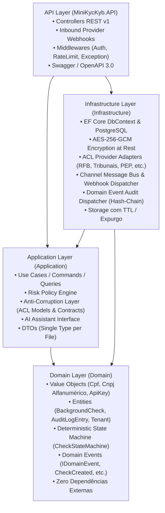
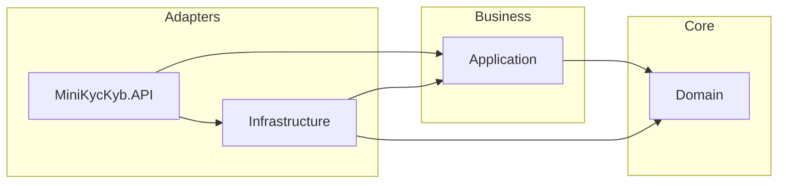

# Clean Architecture & Padrões Estruturais

A **Mini-Plataforma KYC/KYB Background Check** foi concebida seguindo rigorosamente os preceitos da **Clean Architecture** (Robert C. Martin) combinados com princípios de **Domain-Driven Design (DDD)** e uma **Camada Anticorrupção (ACL)**. O objetivo central é manter as regras de negócio regulatórias (como cálculo de CNPJ, classificação de riscos e conformidade LGPD) 100% isoladas de tecnologias voláteis (banco de dados, frameworks web e APIs externas).

---

## 🏛️ Visão Geral em Camadas

---

## 📦 Detalhamento das Camadas

### 1. Camada de Domínio (`src/Domain`)
É o núcleo da aplicação. Não possui dependências externas ou pacotes NuGet de terceiros.
- **Value Objects**:
  - `Cpf`: Validação oficial de 11 dígitos por módulo 11, rejeição de sequências idênticas e máscara LGPD (`***.456.789-**`).
  - `Cnpj`: Suporta tanto o CNPJ tradicional de 14 dígitos quanto o novo **CNPJ Alfanumérico da Instrução Normativa RFB nº 2.229/2024**. Converte caracteres ASCII para inteiros (`ASCII - 48`) e aplica pesos módulo 11.
  - `ApiKey`: Gera chaves no formato seguro `sk_live_...` e armazena apenas seu hash SHA-256 no banco, com verificação em tempo constante (`CryptographicOperations.FixedTimeEquals`).
- **Máquina de Estados Finita Determinística**:
  - `CheckState`: Enumera os estados não-binários (`Pending`, `Processing`, `AwaitingHumanReview`, `Approved`, `Rejected`, `RequiresMoreInfo`, `Failed`, `Purged`).
  - `CheckStateMachine`: Valida e trava transições ilegais, impedindo pulos de etapas ou desrespeito ao fluxo regulatório.
- **Eventos de Domínio (`Domain.Events`)**:
  - `IDomainEvent`, `CheckCreatedEvent`, `CheckProcessingStartedEvent`, `CheckCompletedAwaitingReviewEvent`, `HumanReviewDeliberatedEvent`, `DataRetentionPurgedEvent`.
- **Entidades de Domínio**:
  - `BackgroundCheck`: Agregado raiz da verificação cadastral. Controla estados, prazos de retenção, emissão de eventos e decisão humana (Art. 20 LGPD).
  - `CheckFinding`: Apontamento estruturado (Verde, Amarelo, Vermelho), contendo o "Por que este item?" e o hash da evidência.
  - `AuditLogEntry`: Registro imutável de auditoria encadeado criptograficamente com o registro anterior (*Hash Chain*).
  - `Tenant`, `UsageMetric`, `WebhookSubscription`.

### 2. Camada de Aplicação (`src/Application`)
Orquestra os fluxos de trabalho e abriga os motores de regras de negócio.
- **Camada Anticorrupção (ACL - Modelos Canônicos)**:
  - `CanonicalCadastralProfile`: Modelo canônico para dados cadastrais de PF/PJ.
  - `CanonicalJudicialRecord`: Apontamentos de processos cíveis, criminais e trabalhistas.
  - `CanonicalSanctionRecord`: Sanções, OFAC, CEIS/CNEP e PEP (Pessoa Exposta Politicamente).
  - `CanonicalLaborRecord`: Trabalho análogo à escravidão e autuações do MTE.
  - `CanonicalPartnerRecord`: Quadro de Sócios e Administradores (QSA/KYB).
  - `IProviderAdapter<TCanonical>` e `ProviderAdapterResult<T>`: Contratos que isolam a aplicação de fornecedores externos.
- **Motores de Regras**:
  - `IRiskPolicyEngine` / `RiskPolicyEngine`: Avalia os dados canônicos e emite os indicadores Verde, Amarelo ou Vermelho com a devida justificativa e categoria.
- **Serviços de IA**:
  - `IAiAssistantService`, `GeminiAiAssistantService` e `HeuristicFallbackAiService`: Resumos explicativos grounded em evidências.
- **Casos de Uso (Use Cases)**:
  - `CreateCheckUseCase`, `GetCheckByIdUseCase`, `ReviewCheckUseCase`, `PurgeExpiredChecksUseCase`, `CreateTenantUseCase`, `GenerateApiKeyUseCase`, `GetTenantUsageUseCase`, `GetAuditLogsUseCase`.

### 3. Camada de Infraestrutura (`src/Infrastructure`)
Implementa as interfaces definidas pelo Domínio e Aplicação, conectando-se a recursos externos.
- **Adapters Canônicos da ACL (`Infrastructure.Acl.Adapters`)**:
  - `ReceitaFederalAdapter`, `TribunaisAdapter`, `ListasRestritivasAdapter`, `TrabalhoEscravoAdapter`, `QsaSociosAdapter`.
- **Segurança e Criptografia em Repouso**:
  - `AesEncryptionService`: Criptografia AES-256-GCM com suporte a índices determinísticos (`enc:det:`) para busca e aleatórios (`enc:rnd:`).
  - `EncryptedStringConverter`: ValueConverter do EF Core que criptografa automaticamente colunas de dados pessoais no banco de dados.
- **Sanitização de Logs**:
  - `PiiSanitizer`: Expressões regulares que anonimizam CPFs, CNPJs e chaves de API antes de gravação em telemetria.
- **Armazenamento Seguro com TTL**:
  - `IAttachmentStorageService` e `InMemoryAttachmentStorageService`: Upload, download temporário assinado e expurgo programado de anexos.
- **Mensageria e Auditoria Reativa**:
  - `ChannelMessageBus`: Barramento assíncrono baseado em `System.Threading.Channels` com backpressure.
  - `DomainEventDispatcher`: Despachador de eventos de domínio que alimenta automaticamente a trilha de auditoria encadeada com SHA-256.
- **Persistência**:
  - `KycKybDbContext`: EF Core com PostgreSQL e fallback in-memory automático para testes.

### 4. Camada de Apresentação e API (`src/MiniKycKyb.API`)
Interface HTTP REST v1 com ASP.NET Core Web API.
- **Middlewares**:
  - `ApiKeyAuthMiddleware`: Autenticação e extração de Tenant e Roles (`ComplianceOfficer`, `Auditor`, `StandardUser`). Bypasses configurados para `/swagger`, `/openapi`, `/health` e webhooks.
  - `RateLimitingMiddleware`: Algoritmo Token Bucket em memória (120 req/min por tenant).
  - `ExceptionHandlingMiddleware`: Tratamento global com especificação RFC 7807 (Problem Details).
- **Controllers**:
  - `ChecksController`: Solicitação, consulta com mascaramento e revisão humana.
  - `TenantsController`: Gestão de inquilinos, perfil do inquilino (`GET /me`) e geração de API Keys.
  - `ProviderWebhooksController`: Ingestão assíncrona de webhooks de provedores externos (`POST /api/v1/webhooks/providers/{providerName}`).
  - `MeteringController`: Medição de consumo e bilhetagem.
  - `AuditController`: Consulta à trilha imutável de auditoria.
  - `AtsSimulatorController`: Demonstração da integração com ATS e recebimento de webhooks assinados com HMAC-SHA256.

---

## 🛡️ Regras de Dependência e Isolamento

