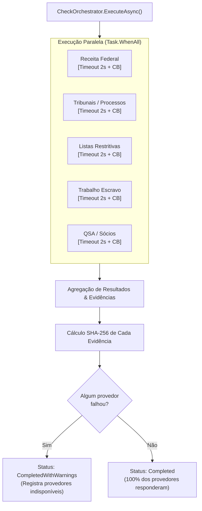
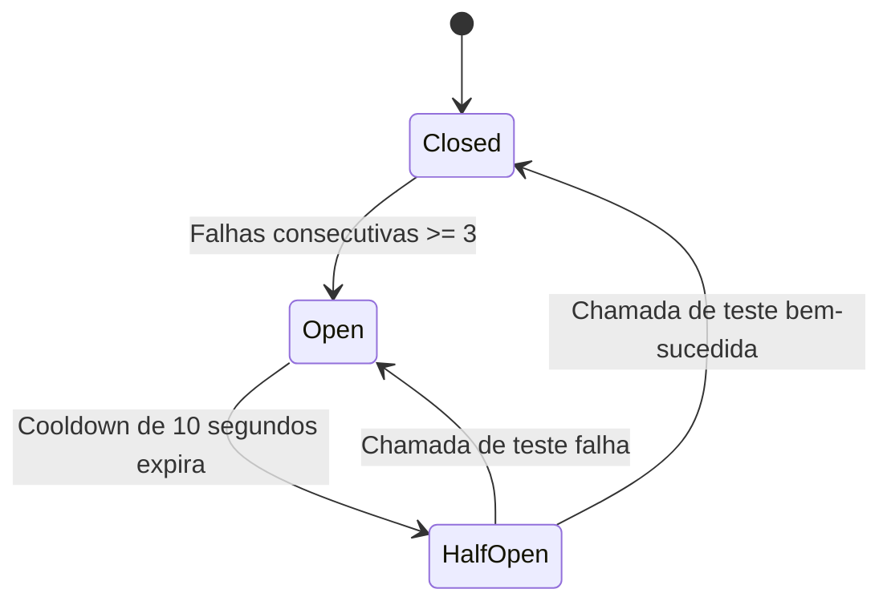

# Pilar 2: Orquestrador Resiliente, Circuit Breaker e Degradação Graciosa

Consultas a órgãos governamentais e provedores legados de Background Check são notórias por instabilidade, lentidão e indisponibilidades imprevistas. Uma arquitetura de classe empresarial não pode tolerar falhas em cascata que travem o fluxo operacional ou derrubem o ATS do cliente.

O `CheckOrchestrator` da **MiniKycKyb** implementa padrões avançados de estabilidade:
1. **Disparo Concorrente** (`Task.WhenAll`).
2. **Circuit Breaker** dedicado por provedor (Isolamento de Falhas).
3. **Guarda de Timeout Rígido** (2.0 segundos).
4. **Cache em Memória com TTL** (Redução de custo e latência).
5. **Degradação Graciosa com Resultado Parcial** (`CompletedWithWarnings`).

---

## ⚡ Fluxo de Execução Concorrente

Quando uma solicitação é iniciada, o orquestrador aciona os 5 provedores de forma assíncrona e concorrente:



---

## 🔌 Máquina de Estados do Circuit Breaker (`src/Infrastructure/Resilience/CircuitBreaker.cs`)

O Circuit Breaker atua como um fusível elétrico para proteger o sistema de insistir em chamadas a provedores fora do ar.



- **Fechado (`Closed`)**: Operação normal. Todas as requisições passam diretamente ao provedor. Falhas incrementam o contador atômico (`Interlocked.Increment`).
- **Aberto (`Open`)**: Se 3 falhas ocorrerem em sequência, o circuito abre. Qualquer nova requisição para esse provedor é imediatamente abortada sem latência de rede, retornando erro de curto-circuito em microssegundos.
- **Meio-Aberto (`HalfOpen`)**: Após o tempo de resfriamento (*cooldown* de 10s), uma única requisição é liberada como teste ("canário"). Se responder com sucesso, o circuito fecha e zera os contadores. Se falhar, o circuito retorna ao estado aberto por mais um ciclo.

---

## ⏱️ Timeout Rígido e Cancelamento Cooperativo

Cada consulta externa é envolvida por um `CancellationTokenSource.CreateLinkedTokenSource` configurado para **2000 ms**:

```csharp
using var timeoutCts = new CancellationTokenSource(TimeSpan.FromSeconds(2));
using var linkedCts = CancellationTokenSource.CreateLinkedTokenSource(cancellationToken, timeoutCts.Token);

try
{
    var rawResult = await provider.FetchDataAsync(check.DocumentDigits, check.SubjectType, linkedCts.Token);
    circuitBreaker.RecordSuccess();
    return rawResult;
}
catch (OperationCanceledException) when (timeoutCts.IsCancellationRequested)
{
    circuitBreaker.RecordFailure();
    return ProviderRawResult.CreateFailed(provider.ProviderName, "Timeout de 2 segundos excedido.");
}
catch (Exception ex)
{
    circuitBreaker.RecordFailure();
    return ProviderRawResult.CreateFailed(provider.ProviderName, $"Erro no provedor: {ex.Message}");
}
```

---

## 🧩 Degradação Graciosa (Graceful Partial Results)

Se um ou mais provedores falharem (seja por timeout, erro interno ou circuito aberto), o sistema **não aborta a checagem**:
1. O status final do processo transiciona para **`CompletedWithWarnings`**.
2. Os dados dos provedores que responderam com sucesso são avaliados normalmente pelo motor de regras.
3. O relatório final inclui apontamentos informativos detalhando quais provedores não puderam ser consultados naquele momento.
4. O cliente ou oficial de compliance é notificado com transparência total, permitindo a tomada de decisão sobre os dados parciais obtidos.

---

## 💾 Camada de Cache em Memória com TTL

Consultas repetidas sobre o mesmo documento dentro da janela de TTL (padrão de 10 minutos) são atendidas diretamente do cache em memória:
- Chave de cache com hash seguro: `kyc_cache:{ProviderName}:{SHA256(DocumentDigits)}`
- Elimina custos duplicados de provedores pagos e reduz a latência de ponta a ponta para menos de **5 milissegundos**.

