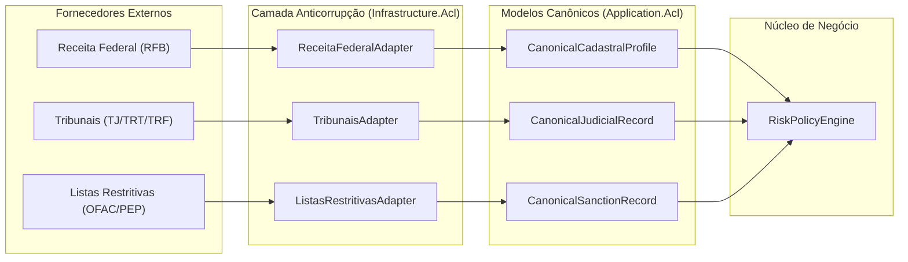
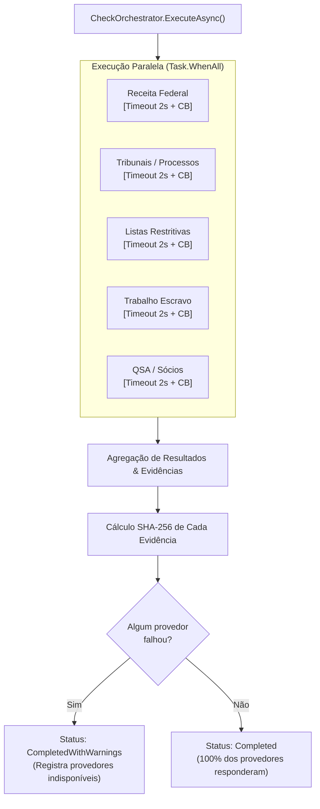
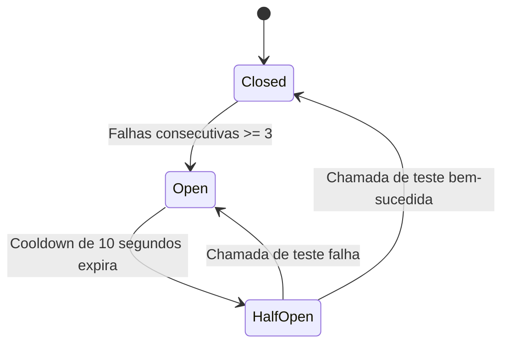

# Pilar 2: Orquestrador Resiliente, Circuit Breaker e Degradação Graciosa

Consultas a órgãos governamentais e provedores legados de Background Check são notórias por instabilidade, lentidão e indisponibilidades imprevistas. Uma arquitetura de classe empresarial não pode tolerar falhas em cascata que travem o fluxo operacional ou derrubem o ATS do cliente.

O `CheckOrchestrator` e a Camada Anticorrupção da **MiniKycKyb** implementam padrões avançados de estabilidade:
1. **Camada Anticorrupção (ACL)**: Isolamento total de fornecedores através de contratos genéricos e modelos canônicos.
2. **Disparo Concorrente** (`Task.WhenAll`).
3. **Circuit Breaker** dedicado por provedor (Isolamento de Falhas).
4. **Guarda de Timeout Rígido** (2.0 segundos).
5. **Cache em Memória com TTL** (Redução de custo e latência).
6. **Degradação Graciosa com Resultado Parcial** (`CompletedWithWarnings`).
7. **Barramento de Mensageria Assíncrona** (`IMessageBus` / `ChannelMessageBus`) para ingestão desacoplada de webhooks.

---

## 🛡️ Camada Anticorrupção (Anti-Corruption Layer - ACL)

Quando integramos provedores externos de background check (como Receita Federal, Serasa, Idwall, CAF, Tribunais de Justiça), cada fornecedor expõe payloads JSON proprietários com nomenclaturas e estruturas distintas. 

Se as regras de negócio consumissem esse JSON diretamente, qualquer mudança de fornecedor exigiria refatoração profunda no núcleo do sistema. 

A Camada Anticorrupção resolve isso através de **Modelos Canônicos** e **Adapters Tipados**:



### Contrato Genérico da ACL: `IProviderAdapter<TCanonical>`

```csharp
public interface IProviderAdapter<TCanonical>
{
    string ProviderKey { get; }
    
    Task<ProviderAdapterResult<TCanonical>> QueryCanonicalAsync(
        string documentNumber,
        SubjectType subjectType,
        CancellationToken cancellationToken = default);
}
```

Se um provedor for substituído ou mudar sua API REST, **apenas a classe do Adapter correspondente é modificada**. O repositório, os casos de uso e as políticas de risco permanecem intactos.

---

## ⚡ Fluxo de Execução Concorrente

Quando uma solicitação é iniciada, o orquestrador aciona os provedores de forma assíncrona e concorrente:



---

## 🔌 Máquina de Estados do Circuit Breaker (`src/Infrastructure/Resilience/CircuitBreaker.cs`)

O Circuit Breaker atua como um fusível elétrico para proteger o sistema de insistir em chamadas a provedores fora do ar:



- **Fechado (`Closed`)**: Operação normal. Todas as requisições passam diretamente ao provedor. Falhas incrementam o contador atômico (`Interlocked.Increment`).
- **Aberto (`Open`)**: Se 3 falhas ocorrerem em sequência, o circuito abre. Qualquer nova requisição para esse provedor é imediatamente abortada sem latência de rede, retornando erro de curto-circuito em microssegundos.
- **Meio-Aberto (`HalfOpen`)**: Após o tempo de resfriamento (*cooldown* de 10s), uma única requisição é liberada como teste ("canário"). Se responder com sucesso, o circuito fecha e zera os contadores. Se falhar, o circuito retorna ao estado aberto por mais um ciclo.
