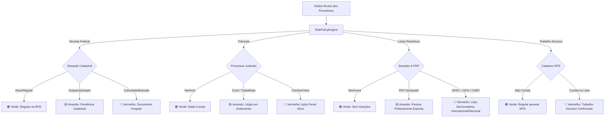

# Pilar 3: Motor de Políticas de Risco, Explicações e Evidências Criptográficas

Um dos maiores problemas em soluções de Background Check legadas é a opacidade: o sistema emite um "score" numérico misterioso ou uma cor sem qualquer explicação sobre qual fato gerador motivou aquele julgamento, inviabilizando o direito à ampla defesa e a conformidade com o Artigo 20 da LGPD.

A plataforma **MiniKycKyb** adota uma abordagem estritamente determinística, transparente e baseada em evidências auditáveis.

---

## 🚦 Semáforo de Risco por Categoria

Cada verificação analisa múltiplas categorias e gera apontamentos (`CheckFinding`) classificados em três níveis:

| Indicador | Significado | Exemplo Prático |
| --- | --- | --- |
| 🟢 **Verde (`Green`)** | Conforme / Baixo Risco | Situação Cadastral regular na Receita Federal; ausência de registros restritivos. |
| 🟡 **Amarelo (`Yellow`)** | Atenção / Risco Médio | Ação cível em andamento com valor moderado; processo trabalhista em fase de recurso; pessoa classificada como PEP. |
| 🔴 **Vermelho (`Red`)** | Bloqueante / Risco Crítico | Presença na Lista de Trabalho Escravo do MTE; condenação criminal ativa; sanção na lista OFAC/CEIS; CNPJ cancelado/inapto. |

### Cálculo do Indicador Global da Checagem

O risco global (`OverallRiskIndicator`) do `BackgroundCheck` é determinado pela regra da severidade máxima:
$$\text{Risco Global} = \max(\text{Findings})$$
Se houver pelo menos um apontamento **Vermelho**, o risco global é **Vermelho**. Se não houver Vermelhos mas houver pelo menos um **Amarelo**, o risco é **Amarelo**. Caso contrário, é **Verde**.

---

## 📝 O Requisito "Por que este item?" (`ExplanationWhy`)

Nenhum apontamento é emitido sem uma justificativa legível por humanos. No código, cada `CheckFinding` exige:

1. `Category`: Nome da categoria inspecionada (`Cadastral`, `Judicial`, `Restritiva`, `TrabalhoEscravo`, `Societario`).
2. `Indicator`: Nível de risco (`Green`, `Yellow`, `Red`).
3. `Title`: Título resumido do apontamento (ex: *"Inclusão no Cadastro de Trabalho Escravo (MTE)"*).
4. `ExplanationWhy`: Descrição detalhada do fato gerador (ex: *"O documento consta na atualização mais recente do Cadastro de Empregadores do MTE, o que representa risco de conformidade inaceitável e vedação legal de contratação."*).
5. `EvidenceKey` e `EvidenceHashSha256`: Vínculo inalterável com os dados brutos recebidos da fonte.

---

## 🔐 Integridade e Não-Repúdio via SHA-256

Para impedir qualquer alegação futura de que os dados foram alterados manualmente após a checagem, cada payload JSON recebido de um provedor é submetido a uma função de espalhamento criptográfico **SHA-256**:

$$\text{EvidenceHash} = \text{SHA-256}(\text{CanonicalJson}(\text{RawProviderData}))$$

```csharp
using var sha256 = SHA256.Create();
var bytes = Encoding.UTF8.GetBytes(finding.RawEvidenceJson);
var hashBytes = sha256.ComputeHash(bytes);
var hashString = Convert.ToHexString(hashBytes).ToLowerInvariant();
```

Esse hash é armazenado na entidade `CheckFinding` e em `AuditLogEntry`. Qualquer auditor pode comparar o hash com os dados arquivados para comprovar matematicamente que o relatório reflete com exatidão o que o provedor externo respondeu naquele milissegundo.

---

## ⚖️ Mapeamento de Regras do `RiskPolicyEngine`


