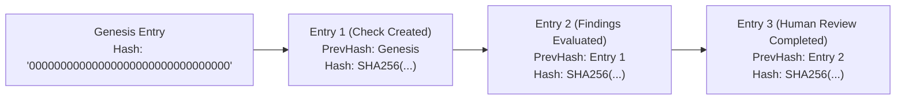

# Pilar 4: LGPD por Design, Governança e o Artigo 20

A Lei Geral de Proteção de Dados (Lei nº 13.709/2018 - LGPD) impõe regras estritas para o tratamento de dados pessoais em processos de verificação cadastral e prevenção à fraude.

A plataforma **MiniKycKyb** foi construída desde a primeira linha de código com o princípio de **Privacy and Compliance by Design**, cobrindo todas as exigências legais e técnicas.

---

## 🔒 1. Criptografia em Repouso no Banco de Dados (AES-256-GCM)

Para garantir sigilo e confidencialidade no armazenamento relacional (PostgreSQL), todos os campos identificadores de pessoas físicas e jurídicas são criptografados através do `EncryptedStringConverter` do EF Core.

### Especificação Criptográfica
* **Algoritmo:** AES-256 em modo GCM (Galois/Counter Mode) com autenticação de integridade integrada (AEAD).
* **Chave:** 256 bits (32 bytes).
* **Nonces:** 96 bits (12 bytes).
* **Tags de Integridade:** 128 bits (16 bytes).

### Estratégia de Indexação e Busca
* **Criptografia Determinística (`enc:det:`)**: Utilizada no campo `DocumentNumber`. O Nonce é derivado deterministicamente de `HMAC-SHA256(Documento, Chave)`. Isso permite buscas diretas por igualdade no PostgreSQL via LINQ (`WHERE DocumentNumber = @doc`) com índice B-tree preservado, sem revelar o documento no disco.
* **Criptografia Probabilística (`enc:rnd:`)**: Utilizada nos campos `Name` e `RawEvidenceJson`, com Nonce aleatório por operação.

```sql
-- Exemplo de registro gravado no PostgreSQL:
SELECT "Id", "DocumentNumber", "Name" FROM background_checks LIMIT 1;

-- DocumentNumber: enc:det:LTxiZBgvR0NUL9KZS45XC+Lp+dnlnJYYs8IVrNOkhXMK80cS4vlx
-- Name:           enc:rnd:Vz9DYcINLvfcNAAZ1Z27nHmHrLS+jxle6oiT/H21X6uJTfIsZYub7yodN3xymw==
```

---

## 🧹 2. Sanitização de PII em Logs de Aplicação (`IPiiSanitizer`)

> [!CAUTION]
> **NUNCA** grave CPFs, CNPJs, tokens ou credenciais em texto claro nos logs de aplicação (`ILogger`, arquivos de log, dashboards ou saídas de terminal).

A classe `PiiSanitizer` aplica expressões regulares compiladas para anonimizar automaticamente dados sensíveis em tempo real:
- CPFs formatados e brutos são substituídos por máscaras no formato `***.982.247-**`.
- CNPJs são substituídos por máscaras `**.222.333/****-**`.
- Chaves de API (`sk_live_...`) são substituídas por `sk_live_[REDACTED_API_KEY]`.
- Tokens Bearer são substituídos por `Bearer [REDACTED_TOKEN]`.

---

## ⚖️ 3. A Regra de Ouro: Artigo 20 da LGPD (Revisão Humana Obrigatória)

O Artigo 20 da LGPD estabelece expressamente:
> *"O titular dos dados tem direito a solicitar a revisão de decisões tomadas unicamente com base em tratamento automatizado de dados pessoais que afetem seus interesses, incluídas as decisões destinadas a definir o seu perfil pessoal, profissional, de consumo e de crédito ou os aspectos de sua personalidade."*

### Como o MiniKycKyb Cumpre Essa Exigência
1. **O Sistema NUNCA Reprova Sozinho**: O motor de regras automatizado classifica riscos e emite semáforos, mas seu status final transiciona para **`AwaitingHumanReview`** via `CheckStateMachine`.
2. **Fluxo Human-in-the-Loop Obrigatório**: Uma decisão que desqualifique um candidato ou parceiro só pode ser proferida por um ser humano habilitado (Oficial de Compliance / Analista de Risco).
3. **Ponto de Extremidade de Revisão Humana**:
   `POST /api/v1/checks/{id}/review`
   - Exige perfil autorizado (`ComplianceOfficer`).
   - Registra a decisão (`ApprovedByHuman`, `RejectedByHuman`, `AdditionalInformationRequested`).
   - Exige justificativa formal textual (`notes`), armazenada para fins de auditoria e prestação de contas ao titular.

---

## ⛓️ 4. Trilha de Auditoria Criptograficamente Imutável (*Hash Chain*)

Cada evento de domínio (`CheckCreatedEvent`, `CheckProcessingStartedEvent`, `HumanReviewDeliberatedEvent`, `DataRetentionPurgedEvent`) é capturado pelo `DomainEventDispatcher` e gravado na tabela `AuditLogEntries`:



### Cálculo do Hash Encadeado:
$$\text{EntryHash}_k = \text{SHA-256}\left(\text{Hash}_{k-1} \,\|\, \text{Timestamp} \,\|\, \text{TenantId} \,\|\, \text{Actor} \,\|\, \text{Action} \,\|\, \text{Resource} \,\|\, \text{Details}\right)$$

Se qualquer linha no banco de dados for alterada retroativamente, o recálculo da cadeia quebra a assinatura das linhas subsequentes, denunciando a violação imediatamente.

---

## 🗑️ 5. Ciclo de Vida e Expurgo Automático por Prazo de Retenção

O princípio da necessidade e da limitação do armazenamento (LGPD, Art. 6º, III e Art. 16) veda a retenção indefinida de dados pessoais após o término da finalidade.

1. **Prazo de Retenção Programado**:
   No momento da criação da checagem, calcula-se o campo `RetentionUntil` com base na finalidade (ex: 30 a 180 dias).
2. **Worker em Segundo Plano (`DataRetentionPurgeWorker`)**:
   Executado periodicamente, busca registros onde `RetentionUntil <= DateTime.UtcNow` e `IsPurged == false`.
3. **Método `PurgePersonalData()` da Entidade**:
   - Transiciona a máquina de estados para `Purged` (estado terminal imutável).
   - Sobrescreve o número do documento por `[EXPURGADO]`.
   - Limpa payloads JSON de evidências brutas e detalhes cadastrais.
   - Emite o evento `DataRetentionPurgedEvent`.
   - Mantém os metadados agregados para fins estatísticos e contábeis sem dados identificáveis.

---

## 📦 6. Gestão de Anexos com Expiração TTL (`IAttachmentStorageService`)

Anexos comprobatórios (como documentos enviados via upload para verificação) possuem ciclo de vida rigoroso:
- **Upload com TTL:** Requer definição do período de retenção (`retentionPeriod`).
- **Bloqueio de Leitura Expirada:** Tentativas de download de arquivos cujo tempo expirou retornam nulo imediatamente.
- **Expurgo Físico:** Rotinas de expurgo removem permanentemente os bytes do armazenamento após o vencimento.
