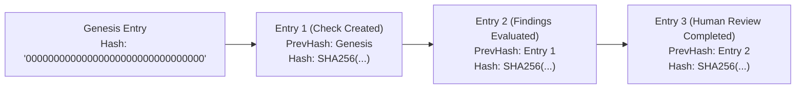

# Pilar 4: LGPD por Design, Governança e o Artigo 20

A Lei Geral de Proteção de Dados (Lei nº 13.709/2018 - LGPD) impõe regras estritas para o tratamento de dados pessoais em processos de verificação cadastral e prevenção à fraude.

A plataforma **MiniKycKyb** foi construída desde a primeira linha de código com o princípio de **Privacy and Compliance by Design**, cobrindo todas as exigências legais e técnicas.

---

## ⚖️ A Regra de Ouro: Artigo 20 da LGPD (Revisão Humana Obrigatória)

O Artigo 20 da LGPD estabelece expressamente:
> *"O titular dos dados tem direito a solicitar a revisão de decisões tomadas unicamente com base em tratamento automatizado de dados pessoais que afetem seus interesses, incluídas as decisões destinadas a definir o seu perfil pessoal, profissional, de consumo e de crédito ou os aspectos de sua personalidade."*

### Como o MiniKycKyb Cumpre Essa Exigência

1. **O Sistema NUNCA Reprova Sozinho**: O motor de regras automatizado classifica riscos e emite semáforos, mas seu status final permanece como **`Completed`** com **`HumanReviewStatus = AwaitingReview`**.
2. **Fluxo Human-in-the-Loop Obrigatório**: Uma decisão que desqualifique um candidato ou parceiro só pode ser proferida por um ser humano habilitado (Oficial de Compliance / Analista de Risco).
3. **Ponto de Extremidade de Revisão Humana**:
   `POST /api/v1/checks/{id}/review`
   - Exige perfil autorizado (`ComplianceOfficer`).
   - Registra a decisão (`ApprovedByHuman`, `RejectedByHuman`, `AdditionalInformationRequested`).
   - Exige justificativa formal textual (`notes`), armazenada para fins de auditoria e prestação de contas ao titular.

---

## ⛓️ Trilha de Auditoria Criptograficamente Imutável (*Hash Chain*)

Para garantir que logs de auditoria não possam ser adulterados nem mesmo por administradores de banco de dados, cada entrada na tabela `AuditLogEntries` implementa uma corrente criptográfica encadeada (semelhante a uma blockchain):

### Cálculo do Hash Encadeado

$$\text{EntryHash}_k = \text{SHA-256}\left(\text{Hash}_{k-1} \,\|\, \text{Timestamp} \,\|\, \text{TenantId} \,\|\, \text{Actor} \,\|\, \text{Action} \,\|\, \text{Resource} \,\|\, \text{Details}\right)$$

Se qualquer linha no banco de dados for alterada retroativamente, o recálculo da cadeia quebra a assinatura das linhas subsequentes, denunciando a violação imediatamente.

---

## 🗑️ Ciclo de Vida e Expurgo Automático por Prazo de Retenção

O princípio da necessidade e da limitação do armazenamento (LGPD, Art. 6º, III e Art. 16) veda a retenção indefinida de dados pessoais após o término da finalidade.

1. **Prazo de Retenção Programado**:
   No momento da criação da checagem, calcula-se o campo `RetentionUntilUtc` com base na finalidade (ex: 90 dias para processos seletivos via ATS, 180 dias para onboarding PJ).
2. **Worker em Segundo Plano (`DataRetentionPurgeWorker`)**:
   Executado a cada 60 minutos, busca registros onde `RetentionUntilUtc <= DateTime.UtcNow` e `IsPurged == false`.
3. **Método `PurgePersonalData()` da Entidade**:
   - Sobrescreve o número do documento por `[EXPURGADO_LGPD]`.
   - Limpa payloads JSON de evidências brutas e detalhes cadastrais.
   - Marca o registro como expurgado e registra um evento na trilha de auditoria.
   - Mantém os metadados agregados (data, tenant, status) para fins de relatório estatístico e contábil sem dados identificáveis.

---

## 🎭 Controle de Acesso por Perfil (RBAC) e Mascaramento de Dados

O acesso aos dados é restrito pelo perfil do usuário autenticado (`X-User-Role`):

| Perfil (`UserRole`) | Visualização de Documento | Visualização de Evidências Brutas | Pode Proferir Decisão (Art. 20) |
| --- | --- | --- | --- |
| **`ComplianceOfficer`** | Documento Completo (`123.456.789-00`) | Acesso Total a JSONs de Tribunais e PEP | Sim (`POST /review`) |
| **`Auditor`** | Documento Mascarado (`***.456.789-**`) | Acesso a Hashes e Logs Encadeados | Não (Apenas Leitura) |
| **`StandardUser`** | Documento Mascarado (`***.456.789-**`) | Apenas Indicadores e Semáforo | Não |

O mascaramento ocorre na camada de Aplicação (`GetCheckByIdUseCase`) através do serviço `IDataMasker`, assegurando que o dado sensível nunca chegue à camada de rede para usuários não privilegiados.
