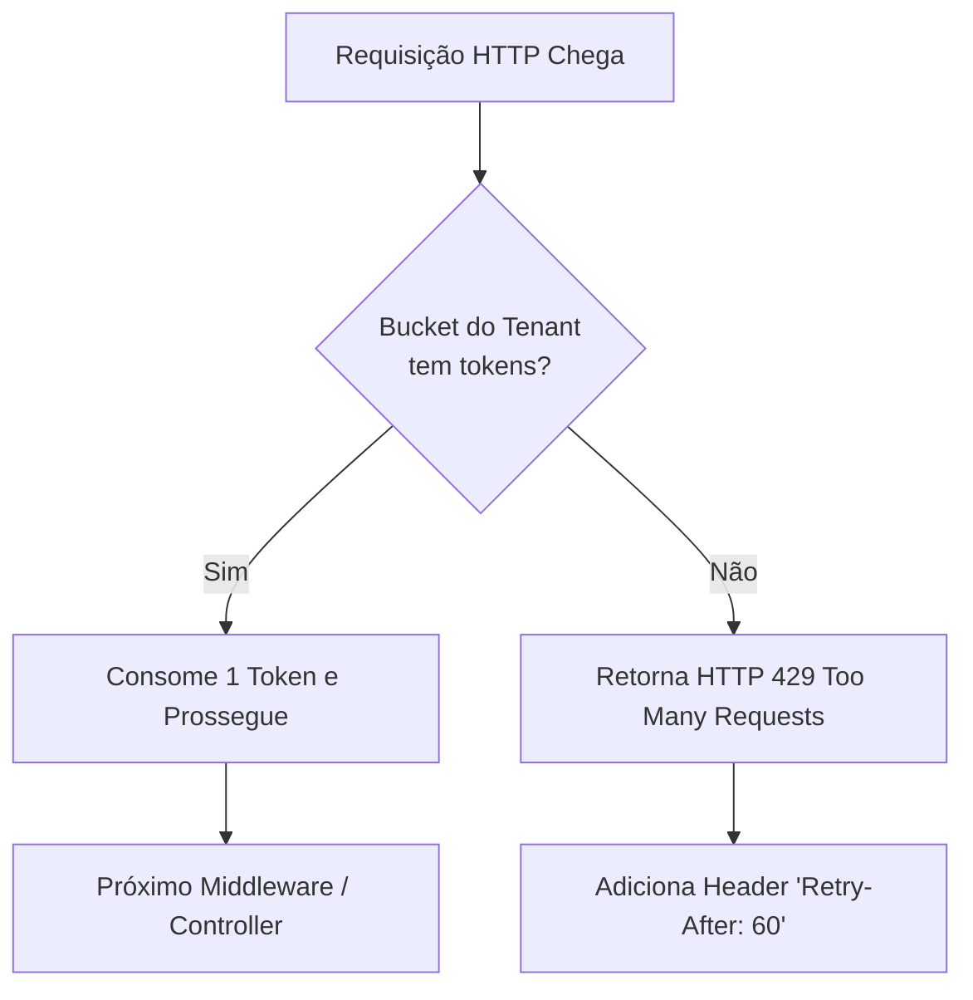

# Pilar 5: SaaS Multi-Tenancy, Autenticação e Medição de Consumo

Projetada como uma solução SaaS B2B, a plataforma **MiniKycKyb** isola completamente os dados de diferentes clientes empresariais e mede com exatidão o consumo de recursos computacionais para fins de bilhetagem e prevenção de abusos.

---

## 🏢 Isolamento Multi-Tenant

Cada requisição à API é associada a um `TenantId` único:
- **Resolução de Contexto**: O middleware `ApiKeyAuthMiddleware` resolve a chave de API e injeta o `ICurrentTenantContext` no escopo da injeção de dependências (`Scoped`).
- **Isolamento em Nível de Repositório**: Todas as consultas EF Core filtram obrigatoriamente por `TenantId`, prevenindo vazamento de dados entre empresas (*cross-tenant leakage*):
  ```csharp
  var check = await _context.BackgroundChecks
      .FirstOrDefaultAsync(c => c.Id == id && c.TenantId == tenantId);
  ```

---

## 🔑 Autenticação Criptográfica com API Keys

As chaves de API seguem o padrão da indústria (estilo Stripe):
- Prefixo identificador de ambiente: `sk_live_...` ou `sk_test_...`
- Alta entropia: 32 bytes gerados por `RandomNumberGenerator.GetBytes`.
- Armazenamento Seguro: **A chave em texto claro nunca é salva no banco de dados**. Apenas o seu hash **SHA-256** é persistido.
- Comparação em Tempo Constante: Para mitigar ataques de temporização (*timing attacks*), a validação utiliza `CryptographicOperations.FixedTimeEquals`.

---

## 🚰 Rate Limiting via Algoritmo Token Bucket

Para proteger a infraestrutura contra sobrecargas e ataques de negação de serviço (DoS), o `RateLimitingMiddleware` implementa um **Token Bucket** em memória por tenant:



- **Capacidade do Balde**: 120 tokens (requisições).
- **Taxa de Recarga**: 2 tokens por segundo (120 requisições por minuto sustentadas).
- **Resposta em Excesso**: Código HTTP `429 Too Many Requests` com corpo no formato RFC 7807 Problem Details.

---

## 📊 Medição de Consumo e Bilhetagem (Metering)

Cada verificação de background check concluída registra um evento contábil na tabela `UsageMetrics`:

```json
{
  "tenantId": "11111111-1111-1111-1111-111111111111",
  "yearMonth": "2026-11",
  "totalChecks": 42,
  "totalProviderCalls": 210,
  "billableUnits": 210,
  "updatedAt": "2026-11-04T12:00:00Z"
}
```

- **Billing Units**: Representam as unidades computacionais consumidas (1 consulta base + 1 unidade por provedor consultado).
- **Consulta de Consumo**: Disponível via `GET /api/v1/metering`, permitindo ao cliente acompanhar seu consumo consolidado no período corrente por tipo de métrica.

