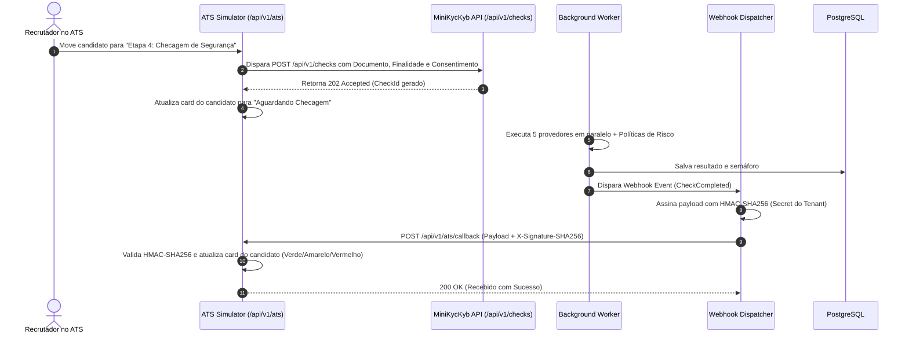

# Pilar 6: Integração com ATS e Despacho de Webhooks Assinados

Em operações de Recursos Humanos em escala, analistas de recrutamento não devem alternar manualmente entre o sistema de gestão de vagas (ATS - Applicant Tracking System) e portais externos de checagem.

A plataforma **MiniKycKyb** fornece um fluxo integrado orientado a eventos para ATS simulados (como Gupy, Greenhouse, Lever ou Workable).

---

## 🔄 Fluxo de Ponta a Ponta: Candidato Muda de Etapa



---

## 🔏 Segurança em Webhooks: Assinatura HMAC-SHA256

Para evitar ataques de falsificação de requisição (*spoofing*), todas as mensagens enviadas para a URL de webhook do cliente são assinadas criptograficamente no cabeçalho HTTP:

$$\text{Assinatura} = \text{HMAC-SHA256}(\text{TenantSecret}, \text{PayloadJson})$$

Cabeçalhos enviados:
```http
POST /webhook-endpoint HTTP/1.1
Host: client-ats.com
Content-Type: application/json
X-Event-Type: CheckCompleted
X-Timestamp: 1730721600
X-Signature-SHA256: 7f83b1657ff1fc53b92dc18148a1d65dfc2d4b1fa3d677284addd200126d9069
```

### Validação pelo Destinatário (C#):
```csharp
using var hmac = new HMACSHA256(Encoding.UTF8.GetBytes(webhookSecret));
var computedHash = hmac.ComputeHash(Encoding.UTF8.GetBytes(rawBodyJson));
var expectedSignature = Convert.ToHexString(computedHash).ToLowerInvariant();

if (!CryptographicOperations.FixedTimeEquals(
    Encoding.UTF8.GetBytes(receivedSignature),
    Encoding.UTF8.GetBytes(expectedSignature)))
{
    return Unauthorized("Assinatura HMAC inválida.");
}
```

---

## 🧪 Endpoints do ATS Simulator Embutido

A API inclui um controlador dedicado para simulação imediata sem necessidade de ferramentas externas:
- **`POST /api/v1/ats/trigger-candidate-stage`**: Simula a mudança de etapa de um candidato, disparando a criação do check.
- **`POST /api/v1/ats/callback`**: Endpoint de escuta que simula o webhook do ATS recebendo a notificação de checagem concluída.
- **`GET /api/v1/ats/received-callbacks`**: Permite inspecionar em tempo real os callbacks recebidos pelo ATS simulado para testes e demonstrações.

