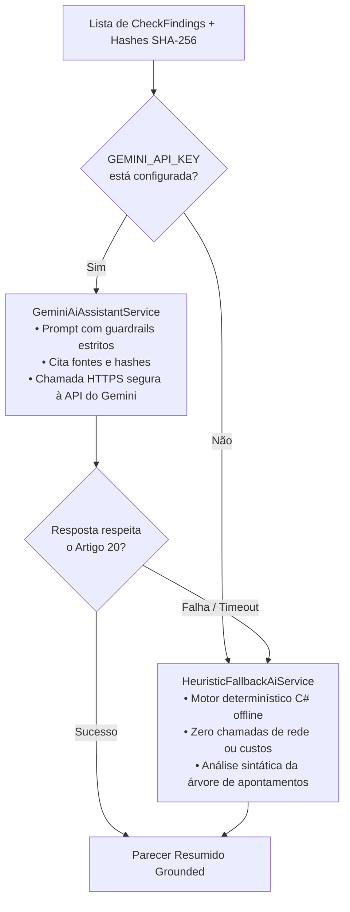

# Pilar 7: Assistente de IA Grounded em Evidências e LGPD Artigo 20

A inteligência artificial generativa em processos de Background Check não deve atuar como juiz sumário. Relatórios automatizados que emitem vereditos de contratação ou descredenciamento violam diretamente o ordenamento jurídico brasileiro e expõem a organização a litígios trabalhistas e danos morais.

O assistente de IA da plataforma **MiniKycKyb** foi desenhado com o propósito de **assistência cognitiva neutra**, sintetizando centenas de páginas de dados brutos e apontando evidências fáticas para que o analista humano tome a decisão final.

---

## 🤖 Arquitetura em Modo Duplo (Dual-Mode)



---

## 🛡️ Guardrails e Prompt Engineering para o Gemini

Quando a chave `GEMINI_API_KEY` está ativa, a chamada ao modelo (ex: `gemini-1.5-flash` ou `gemini-2.0-flash`) é guiada por um prompt com restrições invioláveis:

```text
Você é um Assistente de Análise de Risco Cadastral (KYC/KYB) estritamente em conformidade com o Artigo 20 da LGPD.
Seu objetivo é gerar uma síntese executiva fática e neutra dos apontamentos encontrados.

DIRETRIZES FUNDAMENTAIS:
1. NUNCA decida, recomende aprovação ou desqualificação. Decisões cabem exclusivamente ao Oficial de Compliance humano.
2. CITE nominalmente as fontes e chaves de evidência para cada apontamento mencionado.
3. Se houver apontamentos Vermelhos ou Amarelos, explique objetivamente a causa raiz sem juízo moral.
4. Conclua OBRIGATORIAMENTE com a cláusula de conformidade do Artigo 20 da LGPD.
```

---

## ⚙️ Modo Heurístico Determinístico (Fallback Seguro)

Se a API do Gemini estiver inacessível, com latência elevada ou se o ambiente estiver isolado (*air-gapped* sem internet), o `HeuristicFallbackAiService` assume a execução de forma transparente:
1. Agrupa os apontamentos por nível de severidade (Vermelhos, Amarelos, Verdes).
2. Constrói tópicos fáticos com citação das chaves de evidência (`EvidenceKey`).
3. Anexa o termo legal padronizado:
   > *"AVISO LEGAL (LGPD Art. 20): Este parecer gerado por inteligência artificial é estritamente informativo e destina-se a subsidiar a análise de risco conduzida por um analista humano habilitado. Em cumprimento ao Artigo 20 da Lei 13.709/2018, nenhuma decisão de contratação, recusa ou descredenciamento é tomada de forma exclusivamente automatizada por esta plataforma."*

---

## 🔍 Auditabilidade Total

O parecer gerado pela IA é persistido no campo `AiSummaryText` da entidade `BackgroundCheck`. Como todas as evidências citadas possuem hash SHA-256 anexado, auditores e órgãos fiscalizadores (ANPD, Ministério Público) podem auditar retrospectivamente a consistência lógica entre o resumo e os dados originais recebidos dos órgãos públicos.

